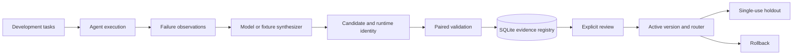

# MORPH

**Measure agent failures, propose executable changes, and evaluate whether they deserve to be kept.**

MORPH is an experimental Python framework for studying improvement around a fixed language model: agent adapters, development-only patch synthesis, bounded execution, paired evaluation, review, routing, rollback, and single-use holdout records.

**Status: experimental preview.** An installed local model generated a signed-addition function that passed 40 validation and 24 holdout tasks in the bounded interpreter. The current evidence covers one synthetic task family.

[Install](docs/installation.md) · [Walkthrough](docs/walkthrough.md) · [Architecture](docs/architecture.md) · [Measured results](reports/README.md) · [Privacy](docs/privacy.md) · [Research](RESEARCH.md) · [Русский](docs/README.ru.md)

## Why MORPH exists

When an agent repeatedly fails, changing its prompt or adding a tool can help. The difficult part is deciding whether that change helps on separate tasks, creates regressions, costs too much, or only fits examples already seen.

MORPH makes these decisions inspectable. A proposal is a candidate with evidence and a recorded runtime. Evaluation compares task-by-task outcomes. A patch needs an explicit review record before activation, and final holdout is kept separate from selection. This is a small experiment harness for agent developers and researchers; arbitrary coding-agent integration remains future work.

## Start without keys, Docker, or a model

Requirements: [Python 3.11+](https://www.python.org/downloads/) and [Git](https://git-scm.com/downloads). Installation is confined to a project virtual environment.

```sh
git clone https://github.com/meanywe54-hub/morph-ai.git
cd morph-ai
python -m venv .venv
```

Windows PowerShell, without activation or changes to execution policy:

```powershell
.\.venv\Scripts\python.exe -m pip install -e .
.\.venv\Scripts\python.exe -m morph.cli demo
.\.venv\Scripts\python.exe -m morph.cli benchmark
```

Linux/macOS:

```sh
.venv/bin/python -m pip install -e .
.venv/bin/python -m morph.cli demo
.venv/bin/python -m morph.cli benchmark
```

The demo's deterministic mock agent mishandles negative inputs. A fixed mock proposal selects signed addition: baseline solves 1/4 validation tasks and the candidate 4/4. The decision is deliberately `inconclusive` because the sample is too small. This verifies plumbing, not autonomous invention or model improvement.

Run `examples/bounded_evolution.py` with the same environment's Python for an offline example that interprets an actual function. Its generator is explicitly a fixed fixture. The [walkthrough](docs/walkthrough.md) explains expected results.

## Implemented capabilities

| Component | Current behavior |
|---|---|
| Agent contract | Minimal `AgentAdapter`; mock and model-backed arithmetic adapters |
| Observations | Answers, reference outcomes, errors, traces, time, calls and available usage |
| Synthesis | OpenAI-compatible model interface; only development failures enter the proposal prompt |
| Execution | Bounded integer-language interpreter; optional experimental Docker Python runtime |
| Evaluation | Paired validation, category outcomes, improvements, regressions and conservative review gate |
| Registry | SQLite reports, immutable patch records, review events and version metadata |
| Router | Active-patch recommendations using matching category evidence and optional historical budgets |
| Holdout | Reservation before evaluation; reused IDs or previously consumed inputs refused in the same registry |
| Local experiments | Ollama loopback baseline and code generation, bounded validation, optional single-use holdout |

Diagnosis remains a simple heuristic. A candidate replaces arithmetic execution; it does not yet teach an arbitrary LLM agent how to use a new tool.

## Lifecycle



Development, validation and holdout have different purposes. Validation can select candidates; final holdout must not tune the same experiment. Exact input overlap is checked, but paraphrases and access outside these APIs cannot be detected.

## Execution and data

`bounded-integer-v1` walks a restricted syntax tree without Python `exec` or `eval`. It has no file/network primitives and enforces syntax, integer, variable and step limits. It is not a general Python sandbox. [Language contract](docs/bounded-runtime.md).

The Docker runtime is experimental. Its command construction and failure paths are tested; live Docker integration was not run for the published measurements. Use a trusted image and daemon on a disposable isolated host. [Security scope](SECURITY.md).

Offline examples do not contact providers. Remote synthesis sends supplied task evidence to the configured provider and may cost money. Local Ollama measurement uses only `127.0.0.1:11434` and bypasses paid-provider credentials. Runtime reports can contain task data and model outputs: keep them private. This release distributes aggregate results, not raw request/response logs. [Privacy details](docs/privacy.md).

## Real measurements

Local `qwen3:4b` produced one executable signed-addition function after two earlier synthesis attempts failed. It solved **40/40** validation tasks against a recorded **1/40** direct-model baseline. On a separate 24-task holdout the function solved **24/24**, while fresh direct calls to `qwen2.5-coder:7b` solved **0/24**. The patch was evaluated in isolation and left inactive. The experiment tests a narrow arithmetic workflow with an unusually weak baseline.

See [results and methodology](reports/README.md) for sample sizes, controls, timing and reproducibility limits. Raw local logs are excluded from the public release.

## Optional model integration

Install the provider extra with `python -m pip install -e '.[openai]'` inside the environment. For an existing Ollama installation, start its local server yourself, create `local-results/`, then run:

```sh
python -m morph.cli local-baseline --model MODEL_NAME --output local-results/baseline.json
```

This makes 42 local calls on the bundled tasks. It does not pull weights or install a service. [Experiment guide](docs/real-model-experiment.md).

`python -m morph.cli --help` lists commands. The [walkthrough](docs/walkthrough.md) covers synthesis, registration, activation, routing, rollback and holdout. A provider is only invoked by an explicitly run model command.

## Development and roadmap

Install `python -m pip install -e '.[dev,openai]'`, then run:

```sh
python -m pytest
python -m ruff check .
python -m ruff format --check .
python -m build
```

Default checks require no paid API; Docker integration is opt-in. [Contributing](CONTRIBUTING.md) covers test scope and review expectations.

Next milestones are broader task contracts, external agent integrations, structured failure diagnosis, matched-budget baselines, independent coding datasets, uncertainty estimates and runtime review. See [ROADMAP.md](ROADMAP.md) and [related work](RESEARCH.md). These are planned capabilities.

## License and maintainer

Apache-2.0 — [LICENSE](LICENSE), [NOTICE](NOTICE). Maintained by [meanywe54-hub](https://github.com/meanywe54-hub). Remove private tasks, keys and personal data before sharing custom reports.
